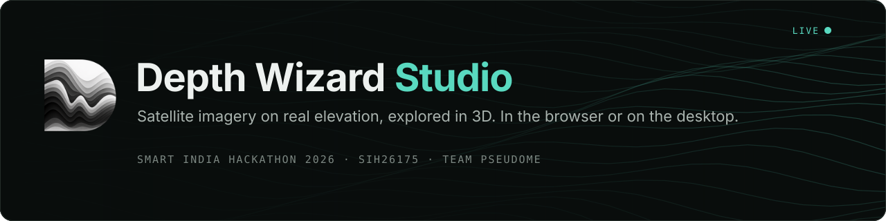
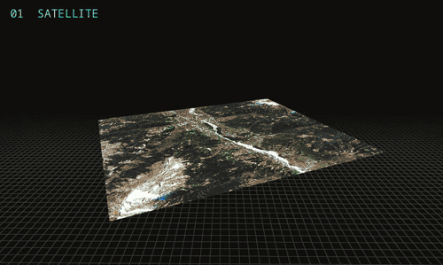
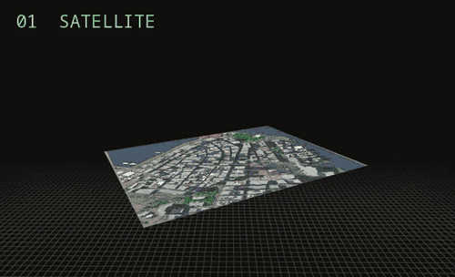
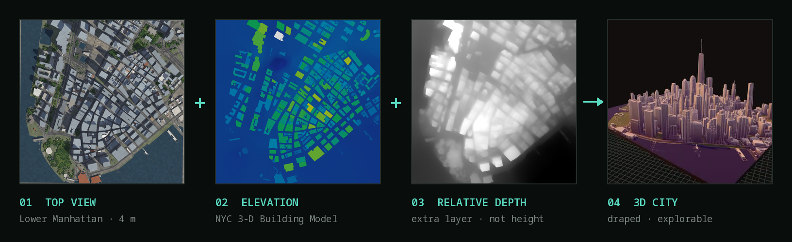
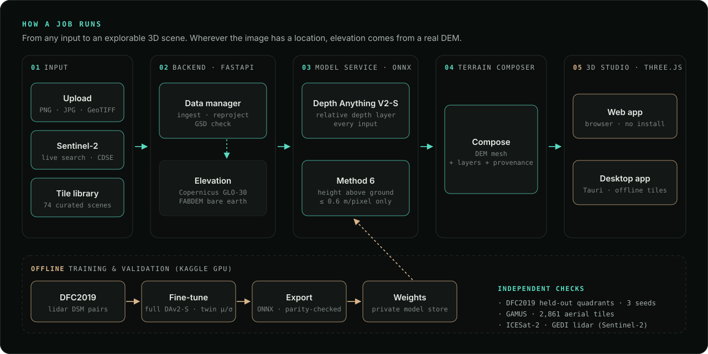
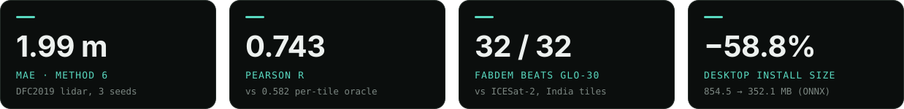

<div align="center">

<a href="https://depthwizard-studio.vercel.app/">
  
</a>

<br>

<a href="https://depthwizard-studio.vercel.app/#/studio"></a>
<a href="https://depthwizard-studio.vercel.app/#demo-video"></a>
<a href="https://github.com/sancharimouri/depthwizard2-desktop/releases/latest"></a>
<a href="LICENSE"></a>


<p>
  <a href="https://depthwizard-studio.vercel.app/"><b>Website</b></a> ·
  <a href="https://depthwizard-studio.vercel.app/#/demo"><b>Interactive demo</b></a> ·
  <a href="#architecture"><b>Architecture</b></a> ·
  <a href="#validated-not-assumed"><b>Validation</b></a> ·
  <a href="#run-it-locally"><b>Run locally</b></a>
</p>

</div>

<table>
  <tr>
    <td width="50%"></td>
    <td width="50%"></td>
  </tr>
  <tr>
    <td align="center"><sub><b>Manali, Himachal Pradesh</b> · Sentinel-2 on a real DEM</sub></td>
    <td align="center"><sub><b>Financial District, New York</b> · 3D city model</sub></td>
  </tr>
  <tr>
    <td colspan="2" align="center"><sub>satellite → relative depth → elevation → DSM → DEM elevation → true colour</sub></td>
  </tr>
</table>

<a name="what-it-is"></a>
<br>
<p><picture>
  <source media="(prefers-color-scheme: dark)" srcset="docs/readme/h/01-what-it-is-dark.svg">
  
</picture></p>

**Depth Wizard Studio turns a satellite image into terrain you can walk through.** Pick a curated tile, search
Sentinel-2 live, or drop in your own PNG, JPG or GeoTIFF. The app drapes the imagery over a real elevation model and
opens it in a 3D studio: orbit, fly through in first person, measure, flood the valley, switch layers.




<a name="features"></a>
<br>
<p><picture>
  <source media="(prefers-color-scheme: dark)" srcset="docs/readme/h/02-features-dark.svg">
  
</picture></p>

<table>
  <tr>
    <td width="33%" valign="top">
      <h4>🛰️ Three ways in</h4>
      74 curated tiles (hilly, urban, agricultural, coastal), live Sentinel-2 search over the Copernicus Data Space,
      or your own upload.
    </td>
    <td width="33%" valign="top">
      <h4>⛰️ Real elevation</h4>
      Copernicus GLO-30 surface and FABDEM bare earth, fetched for your area. GeoTIFFs give metric terrain; plain images
      give relative relief.
    </td>
    <td width="33%" valign="top">
      <h4>🧭 A full 3D studio</h4>
      Orbit and first-person flythrough, true-colour / depth / DEM / wireframe layers, vertical exaggeration, live
      height-and-slope probe.
    </td>
  </tr>
  <tr>
    <td valign="top">
      <h4>📐 Measure & analyse</h4>
      Points, distances and areas on the surface, terrain statistics, and screenshots or short clips of the view.
    </td>
    <td valign="top">
      <h4>🌊 Scenario analysis</h4>
      Flood what-ifs on the terrain, plus hazard facts for the area (ThinkHazard!, GloFAS, USGS, NOAA and more).
    </td>
    <td valign="top">
      <h4>💻 Web and desktop</h4>
      The same app ships as a website and as a Tauri desktop app that runs offline for local tiles.
    </td>
  </tr>
</table>

<a name="architecture"></a>
<br>
<p><picture>
  <source media="(prefers-color-scheme: dark)" srcset="docs/readme/h/03-architecture-dark.svg">
  
</picture></p>



The backend and the model service run as containers on Cloud Run; the web app is static on Vercel. Details:
[docs/ARCHITECTURE.md](docs/ARCHITECTURE.md).

<a name="validated-not-assumed"></a>
<br>
<p><picture>
  <source media="(prefers-color-scheme: dark)" srcset="docs/readme/h/04-validated-not-assumed-dark.svg">
  
</picture></p>



| Where | Result | Against |
|---|---|---|
| **DFC2019** (US cities, 0.3 m) | Method 6: MAE **1.990 m** · RMSE **3.504 m** · Pearson **0.743** · Spearman **0.656** (3 seeds) | per-tile OLS oracle: 3.392 · 4.579 · 0.582 · 0.509 |
| **GAMUS** (2,861 aerial tiles) | Better MAE, Pearson and Spearman; **worse RMSE** (4.583 vs 4.426 m) | the same oracle: so Method 6 is limited to sharp uploads |
| **Sentinel-2, India** (32 tiles, 10 m) | FABDEM median RMSE **1.78 m**, better than GLO-30 on **32 / 32** | ICESat-2 ground photons |

Every rule was pre-registered before its test ran, and the negatives are kept on record.
Read the full method in [**docs/VALIDATION.md**](docs/VALIDATION.md).

<a name="imagery-tiers"></a>
<br>
<p><picture>
  <source media="(prefers-color-scheme: dark)" srcset="docs/readme/h/05-imagery-tiers-dark.svg">
  
</picture></p>

| Tier | Source | Resolution | What you get |
|---|---|---|---|
| **1 · always** | Sentinel-2 via the Copernicus Data Space | 10 m | Real DEM terrain + relative-depth layer, anywhere on Earth |
| **2 · where it exists** | Maxar Open Data, or your own sharp image | ~0.3 m | Adds Method 6 predicted height above ground |

<a name="built-with"></a>
<br>
<p><picture>
  <source media="(prefers-color-scheme: dark)" srcset="docs/readme/h/06-built-with-dark.svg">
  
</picture></p>

<p>


</p>

<a name="run-it-locally"></a>
<br>
<p><picture>
  <source media="(prefers-color-scheme: dark)" srcset="docs/readme/h/07-run-it-locally-dark.svg">
  
</picture></p>

```bash
npm install && npm install --prefix frontend
cp .env.example .env        # add your CDSE_CLIENT_ID / CDSE_CLIENT_SECRET
npm run dev                 # backend :8000 + frontend :5173, one terminal
```

Open **http://localhost:5173**. A preflight check runs first and stops with a clear message if a `.env` value, a port
or `node_modules` is missing.

<details>
<summary><b>What's in the repo</b></summary>

```
frontend/   three.js viewer, Studio, Home and the static tile library (Vite)
backend/    FastAPI: uploads, Sentinel-2 search, DEM fetch, per-job generation
docker/     API and model-service containers (Cloud Run)
desktop/    Tauri 2 shell with the backend as an offline sidecar
space/      the Hugging Face Space depth endpoint (fallback)
docs/       architecture, ML pipeline, validation, attributions
```

</details>

<a name="documentation"></a>
<br>
<p><picture>
  <source media="(prefers-color-scheme: dark)" srcset="docs/readme/h/08-documentation-dark.svg">
  
</picture></p>

| Doc | What's inside |
|---|---|
| [Architecture](docs/ARCHITECTURE.md) | tiers, web app, tile library, backend, depth service, desktop app |
| [ML pipeline](docs/ML_PIPELINE.md) | which models and DEMs the product uses, and where |
| [Validation](docs/VALIDATION.md) | references, pre-registered rules, results and the negatives |
| [Desktop app](docs/DESKTOP_APP.md) | build, size and offline behaviour |
| [Attributions](docs/ATTRIBUTIONS.md) | every dataset, model and service, with licences |

<a name="credits"></a>
<br>
<p><picture>
  <source media="(prefers-color-scheme: dark)" srcset="docs/readme/h/09-credits-dark.svg">
  
</picture></p>

<details>
<summary><b>Data and model credits</b> (full table in <a href="docs/ATTRIBUTIONS.md">docs/ATTRIBUTIONS.md</a>)</summary>
<br>

- **Imagery:** Copernicus Sentinel-2 (contains modified Copernicus Sentinel data, via the Copernicus Data Space
  Ecosystem); Maxar (now Vantor) Open Data Program (CC BY-NC 4.0); IEEE GRSS Data Fusion Contest 2019 Track 1 /
  JHU/APL US3D (library tiles, display resolution).
- **Elevation:** Copernicus DEM GLO-30 (© DLR e.V. / © Airbus Defence and Space GmbH, provided under COPERNICUS by the
  EU and ESA), served for Darjeeling by OpenTopography; FABDEM (Hawker et al. 2022, CC BY-NC-SA 4.0).
- **Models:** Depth Anything V2 Small (Apache-2.0), run by the app; Depth Anything V2 Large (CC BY-NC 4.0), used
  offline only for the four demo regions' precomputed relative-depth images. Yang et al. 2024.
- **Facts and scenario cards:** ThinkHazard! (GFDRR), FAO GAUL 2015, Wikidata, Copernicus EMS / GloFAS, JRC Global
  Surface Water, World Bank / ARUP landslide map, USGS ComCat, NOAA IBTrACS, NOAA SPC.
- **Map tiles:** © OpenStreetMap contributors.

</details>

**Licence:** code under [MIT](LICENSE). Datasets and models keep their own licences, several of them non-commercial.

<div align="center">
<br>
<sub>Built by <b>Team Pseudome</b> for Smart India Hackathon 2026 · problem SIH26175, <i>Single-View Height Estimation and 3D Flythrough</i></sub>
</div>
